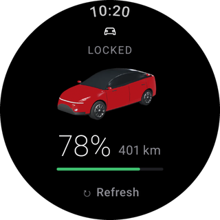
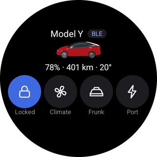
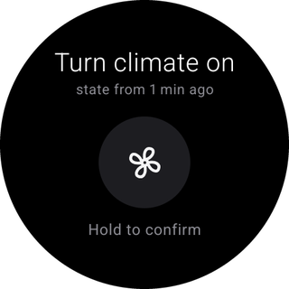
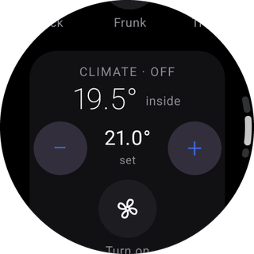
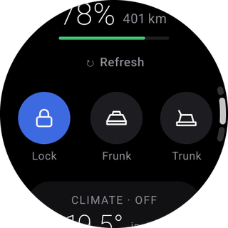

# Wear for Tesla

[](https://github.com/Giack/wear-for-tesla/releases/latest)
[](LICENSE)
[](https://giack.github.io/wear-for-tesla/install/)
[](android/)
[](https://github.com/Giack/wear-for-tesla/actions/workflows/ci.yml)
[](https://giack.github.io/wear-for-tesla/)

A free, open-source Wear OS app that shows your Tesla's state and sends it commands from your wrist. **Bluetooth mode** is the default: the watch talks to the car directly, with its own BLE key, and needs no Tesla account and no server. **Fleet mode** is optional remote control through a Developer app you register yourself.

> **Not affiliated with Tesla, Inc. or Google LLC.** This is an independent project. Tesla, Model 3 and Model Y are trademarks of Tesla, Inc. Wear OS is a trademark of Google LLC. [Disclaimer](https://giack.github.io/wear-for-tesla/disclaimer/).

## On the watch

<table>
  <tr>
    <td align="center" width="20%"><br><sub>Home</sub></td>
    <td align="center" width="20%"><br><sub>Tile</sub></td>
    <td align="center" width="20%"><br><sub>Hold to confirm</sub></td>
    <td align="center" width="20%"><br><sub>Climate</sub></td>
    <td align="center" width="20%"><br><sub>Commands</sub></td>
  </tr>
</table>

Lock, climate, frunk, trunk, charge port, windows, lights and horn. Every command, from the app or the Tile, needs **hold to confirm** and shows how old the known state is. The app never wakes the car just to read it.

## Why the watch has its own BLE key

The car accepts a **Cloud key** (the key of a Developer app, approved through `tesla.com/_ak`) only for commands that arrive through the Fleet API. The same key over Bluetooth is rejected with `MESSAGEFAULT_ERROR_INSUFFICIENT_PRIVILEGES`. It was not added with the driver role.

Bluetooth commands go through VCSEC. The watch asks the car to add its **BLE key** with `ROLE_DRIVER`, and you confirm that request with the **Keycard** on the centre console. Nothing prompts in the Tesla phone app. The private key is created in the Android Keystore and never leaves the watch. Fleet mode does not change this: even with a Cloud key on the watch, Bluetooth still uses the BLE key ([ADR-0001](design/adr/0001-bluetooth-mode-default-own-developer-app.md)).

## Bluetooth mode and Fleet mode

| | Bluetooth mode | Fleet mode |
|---|---|---|
| What it is | The default. The watch and the car, nothing else | Optional remote access through your own Developer app |
| Near the car | State and commands over Bluetooth | Bluetooth first, Fleet API only when the car is out of range |
| From anywhere | | State and commands |
| Account | Not needed | Your Tesla account, and a Developer app you register |
| Server run by this project | None | None. Calls go to Tesla, with your credentials |
| Cost | Free | Tesla's Fleet API prices. The app's budget defaults to $10 a month, the same as Tesla's monthly developer credit |
| Key | BLE key in the Android Keystore | That BLE key, plus the Cloud key for the Fleet API |

The guide is at **[giack.github.io/wear-for-tesla](https://giack.github.io/wear-for-tesla/)**:

- [Install the app](https://giack.github.io/wear-for-tesla/install/) on a Wear OS watch
- [Bluetooth mode](https://giack.github.io/wear-for-tesla/bluetooth-mode/): pair the watch with the Keycard
- [Fleet mode](https://giack.github.io/wear-for-tesla/fleet-mode/): remote control with your own Developer app
- [Fleet API budget](https://giack.github.io/wear-for-tesla/budget/)
- [Troubleshooting](https://giack.github.io/wear-for-tesla/troubleshooting/)
- [Privacy](https://giack.github.io/wear-for-tesla/privacy/): keys, tokens and the VIN stay on the watch

## Public build and Personal build

The repository publishes the **Public build**, application id `io.github.giack.wearfortesla`. Its car images are project-owned Car renders from [`design/car-model`](design/car-model/README.md), tinted with the paint colour. There is no Tesla logo and no Official render.

The **Personal build** (`dev.giack.teslawear`) is the maintainer's own install. Tesla-owned material stays in git-ignored sources and is never built in CI. The two application ids can be installed side by side, each with its own BLE key. See [ADR-0002](design/adr/0002-tesla-material-only-in-personal-build.md).

## Building

```sh
cd android
./gradlew :wear:assemblePublicRelease   # APK in wear/build/outputs/apk/public/release/
./gradlew test                          # JVM tests
```

CI runs `./gradlew test :wear:lintPublicRelease :wear:assemblePublicRelease`.

The site is [MkDocs Material](https://squidfunk.github.io/mkdocs-material/), built from `docs/`:

```sh
pip install -r requirements-site.txt
mkdocs build --strict
```

Design notes and decision records are in `design/`. Vocabulary for the project is in [GLOSSARY.md](GLOSSARY.md).

## Contributing

Pull requests are welcome: read [CONTRIBUTING.md](CONTRIBUTING.md) first. Changes reach `main` only through reviewed pull requests. Report security problems privately ([SECURITY.md](SECURITY.md)).

## Privacy and licence

Nothing is sent to the project: see [PRIVACY.md](PRIVACY.md). Licensed under the [Apache License 2.0](LICENSE).
