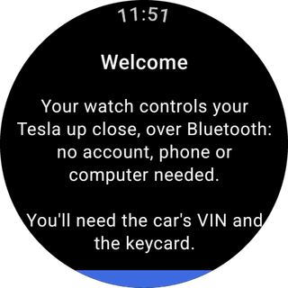
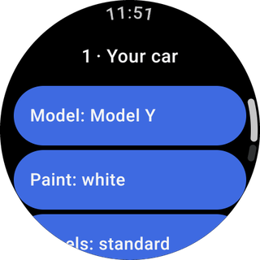
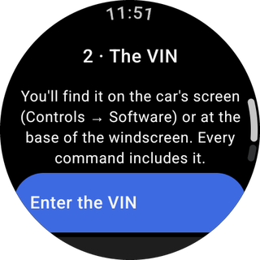
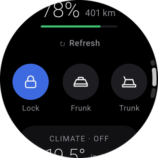
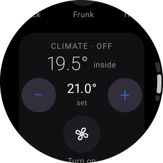

# Bluetooth mode

In Bluetooth mode the watch talks to the car directly, like the Tesla phone app does when you walk up to it. You need the watch, the car, its **Keycard** and its **VIN**: no Tesla account and no computer.

## Before you start

- Sit in the car with the doors closed and the Keycard in your hand.
- Find the **VIN**: it is on the car's screen under **Controls → Software**, and at the base of the windscreen. The car signs every Bluetooth message with it, so the app needs it.
- Turn on the watch's Bluetooth (and location, if the watch asks for it to scan).

## Pairing, step by step

<figure markdown="span">

<figcaption>Welcome</figcaption>
</figure>
<figure markdown="span">

<figcaption>1 · Your car</figcaption>
</figure>
<figure markdown="span">

<figcaption>2 · The VIN</figcaption>
</figure>

1. **Welcome.** Tap **Start**.
2. **Your car.** Pick the model, paint and wheels. This only chooses the picture: the car does not report its configuration over Bluetooth. (Fleet mode replaces it later with the real one.)
3. **The VIN.** Tap **Enter the VIN** and type it with the watch keyboard, by voice, or from your phone. Case, spaces and dashes don't matter; the letters I, O and Q never appear in a VIN and are rejected.
4. **Find the car nearby.** Allow the Bluetooth permissions when asked. The watch looks for the car whose Bluetooth name matches your VIN, so with several Teslas around it still finds yours.
5. **Bluetooth key.** Tap **Pair**. The watch creates its **BLE key** (it never leaves the watch) and sends the request to the car.
6. When the watch says **"Place the keycard on the centre console NOW"**, put the Keycard on the console (behind the cup holders) and confirm on the car's screen. **No request appears in the Tesla phone app** for this pairing, so don't wait for one.
7. The watch shows **Bluetooth key paired ✓** and opens the home screen with the car's state.

You can check the new key on the car's screen under **Controls → Locks**.

## Everyday use

<figure markdown="span">

<figcaption>State</figcaption>
</figure>
<figure markdown="span">

<figcaption>Commands</figcaption>
</figure>
<figure markdown="span">

<figcaption>Climate</figcaption>
</figure>
<figure markdown="span">

<figcaption>Tile</figcaption>
</figure>

- The home screen shows lock state, doors, trunk, frunk, battery and climate whenever the car is within Bluetooth range (a few metres to a few tens of metres).
- Commands work the same way. Hold the button until the ring fills to confirm.
- When the car is out of range the app says **"Car out of Bluetooth range"**; remote-only features are not offered. For those, see [Fleet mode](fleet-mode.md).
- Add the **Tile** from the watch's tile list, and the **Car battery** or **Car climate** complication from your watch face's editor.

## Removing the car

**Settings → Remove car** (tap twice to confirm) deletes the BLE key, the car and anything imported for Fleet mode from the watch. To remove the key from the car too, delete it on the car's screen under **Controls → Locks**.
