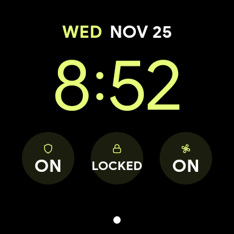

# Complications

Watch-face complications show the car without opening the app. Add them from the watch face editor. They are separate from the [Tile](tile.md).

Short text and icon slots are both offered. Those are the slots the usual watch faces accept.

## What you can add

| Complication | What it shows | Tap |
|---|---|---|
| **Car battery** | Charge, as a percentage | Opens the app |
| **Car climate** | Cabin temperature when climate is on, otherwise off | Hold to confirm climate |
| **Lock status** | Locked or unlocked, with a lock icon | Opens the app |
| **Lock** | Locked or unlocked | Hold to confirm lock or unlock |
| **Climate** | On or off | Hold to confirm climate |
| **Sentry** | On or off | Hold to confirm sentry |

**Car climate** is the temperature. **Climate** is the on/off shortcut. Lock status and **Lock** show the same words. Lock status only opens the app. **Lock** opens hold to confirm, and that screen names the exact action (lock or unlock) before anything is sent.

## No data, or the car is asleep

A dash means the watch is not claiming a state. That is what you see before the first reading, when a field was never reported, and when the car is asleep. Lock, climate and sentry from before the car fell asleep stay hidden: that reading can be wrong, and a complication will not show it as current. The icon is a dash as well, not a closed lock, a fan or a shield.

The battery percentage stays. That figure is the last charge the watch recorded, and it does not flip while the car sleeps the way the lock can.

A command complication still opens hold to confirm when the face shows a dash. The confirmation screen says the state is unknown. Nothing is sent until the ring fills.

## What a tap does not do

A tap never runs a command by itself. Command complications open the same hold-to-confirm screen as the app and the Tile.

Showing a complication does not wake the car and does not call the Fleet API. The watch face is redrawn from the snapshot already stored, when the app, the Tile or the background check saves a new one. Waking happens only for a command you have confirmed, or when you tap **Refresh** in the app.
