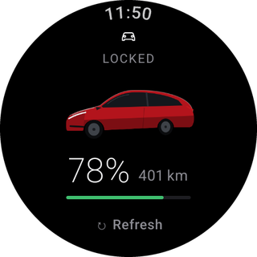
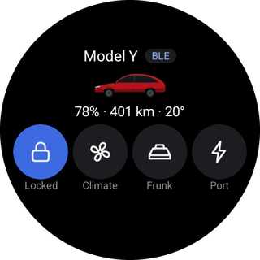
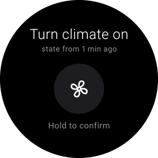
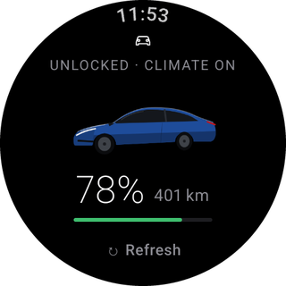

# Wear for Tesla

Wear for Tesla is a free, open-source Wear OS app that shows your Tesla's state on your wrist and sends it commands: lock and unlock, climate, frunk, trunk, charge port, windows, lights and horn. It also gives you a Tile and watch-face complications for the battery and the climate.

<figure markdown="span">

<figcaption>Home</figcaption>
</figure>
<figure markdown="span">

<figcaption>Tile</figcaption>
</figure>
<figure markdown="span">

<figcaption>Hold to confirm</figcaption>
</figure>
<figure markdown="span">

<figcaption>Your model and paint</figcaption>
</figure>

!!! warning "Not affiliated with Tesla, Inc. or Google LLC"
    This is an independent project. See the [disclaimer](disclaimer.md).

## Two ways to use it

**Bluetooth mode** (the default) needs nothing but the watch, the car and its Keycard. The watch creates its own **BLE key**, you confirm it with the Keycard once, and from then on the watch talks to the car directly whenever it is nearby. No Tesla account, server or computer is involved after installation. [Set up Bluetooth mode](bluetooth-mode.md).

**Fleet mode** (optional) adds remote control through Tesla's Fleet API: climate from home, state from anywhere, and the car's real model, paint and wheels. It needs your own **Developer app** on developer.tesla.com, set up with a helper script. The project never runs a shared server, so you control your own access and pay Tesla for your own usage, within a [monthly budget](budget.md) you choose. [Set up Fleet mode](fleet-mode.md).

| | Bluetooth mode | Fleet mode |
|---|---|---|
| State and commands near the car | ✓ | ✓ (over Bluetooth first) |
| State and commands from anywhere | | ✓ |
| Tesla account | not needed | needed |
| Computer | only to install the APK | also for the one-time setup |
| Cost | free | Tesla's Fleet API prices, capped by your budget |

## Safety

Every command, from the app or the Tile, needs **hold to confirm**, and the confirmation shows the exact action and how old the known state is. The app never wakes the car just to read its state: in Fleet mode it wakes the car only to run a command you confirmed.

## Getting started

1. [Install the app on your watch](install.md).
2. [Pair it with your car over Bluetooth](bluetooth-mode.md).
3. Optionally, [enable Fleet mode](fleet-mode.md).

Something not working? See [troubleshooting](troubleshooting.md). Curious about your data? See [privacy](privacy.md): keys, tokens and the VIN stay on the watch.
