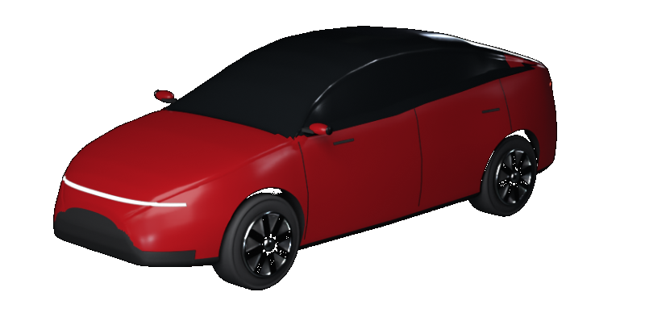
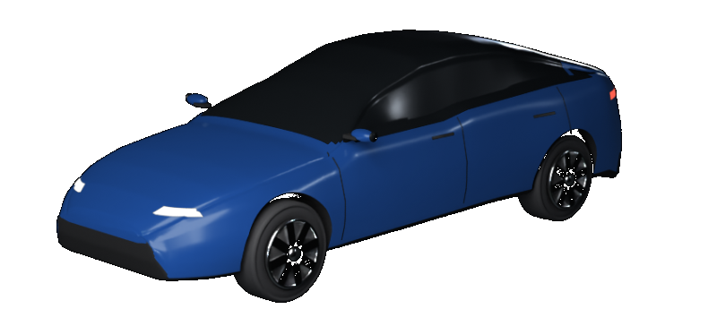
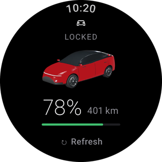
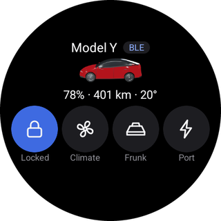
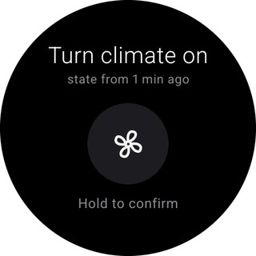
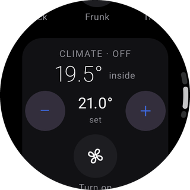
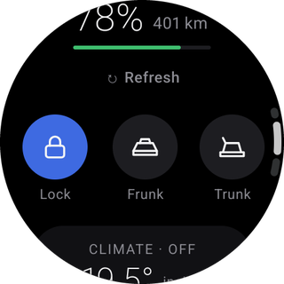

Wear OS 4 and later · Apache-2.0

# Your Tesla, from your wrist.

Wear for Tesla shows your car's state and sends commands from a watch: over Bluetooth when the car is near, and, if you turn it on, through Tesla's Fleet API from anywhere. Bluetooth mode needs no Tesla account. The project runs no server in between.

<figure markdown="span">

<figcaption>Model Y</figcaption>
</figure>

<figure markdown="span">

<figcaption>Model 3</figcaption>
</figure>

Project-owned Car renders, tinted with the paint colour. The Public build ships no Tesla logos and no Official renders.

[Download the latest APK](https://github.com/Giack/wear-for-tesla/releases/latest){ .md-button .md-button--primary }
[Quick setup guide](install.md){ .md-button }
[Source on GitHub](https://github.com/Giack/wear-for-tesla){ .md-button }

**Apache-2.0**

Public build, 100% open source

**Direct BLE**

No intermediate server

**Android Keystore**

Private key stays on the watch

## On the watch

<figure markdown="span">

<figcaption>Home</figcaption>
</figure>

<figure markdown="span">

<figcaption>Tile</figcaption>
</figure>

<figure markdown="span">

<figcaption>Hold to confirm</figcaption>
</figure>

<figure markdown="span">

<figcaption>Climate</figcaption>
</figure>

<figure markdown="span">

<figcaption>Lock, frunk, trunk</figcaption>
</figure>

## Bluetooth mode and Fleet mode

<article class="mode" markdown>

Default

### Bluetooth mode

The watch, the car and its Keycard. No Tesla account and no computer after you install the app.

- State and commands when the car is nearby, straight over Bluetooth
- No third-party server, and nothing to register
- A dedicated BLE key, stored in the Android Keystore, confirmed once with the Keycard
- Free. Bluetooth mode makes no Fleet API calls

[Set up Bluetooth mode](bluetooth-mode.md)

</article>

<article class="mode" markdown>

Optional

### Fleet mode

Remote control through your own Developer app on developer.tesla.com. The project never runs a shared app, so nobody else sits between you and the car, and nobody else pays your usage.

- State and commands from anywhere. Near the car, Bluetooth is still used first
- The car's real model, paint and wheels replace the ones you picked
- Tesla bills the Developer app's owner. The in-app budget defaults to $10 a month, the same as Tesla's monthly developer credit, so with the default you should not pay anything
- You can turn Fleet mode off on the watch and revoke the key on the car

[Set up Fleet mode](fleet-mode.md) · [How the budget is counted](budget.md)

</article>

!!! info "Why the watch pairs its own BLE key"
    A Cloud key is registered for your Developer app's domain and approved in the Tesla phone app (`tesla.com/_ak`). The car accepts that key only for Fleet API commands. Over Bluetooth it answers `MESSAGEFAULT_ERROR_INSUFFICIENT_PRIVILEGES`: the key was not added with the driver role the car requires for a direct command. Bluetooth mode therefore creates its own BLE key and you confirm it with the Keycard on the centre console. No pairing request appears in the Tesla phone app. This is true in both modes. The private key is created in the Android Keystore and never leaves the watch.

## Safe on a wrist

<article markdown>

### Hold to confirm

Every command, from the app or the Tile, waits until you hold and the ring fills. The screen names the exact action and how old the known state is, so a bump of the wrist does not open the frunk or honk.

</article>

<article markdown>

### Tile and complications

Add the Tile for battery, range and four commands without opening the app. Watch-face complications show the battery and the climate. The Tile reads over Bluetooth and does not wake the car.

</article>

<article markdown>

### Climate, closures, charge

Lock and unlock, climate, frunk, trunk, charge port, windows, lights and horn. In Fleet mode the app wakes a sleeping car only to run a command you have confirmed. A state read never wakes it.

</article>

## Three steps

**1 · Install the app.** Download the APK from the latest release and sideload it onto a Wear OS 4 or later watch. [Install guide](install.md).

**2 · Pair the BLE key.** Sit in the car, doors closed, Keycard in hand. The watch creates the key and asks you to place the Keycard on the centre console. [Bluetooth mode](bluetooth-mode.md).

**3 · Use it from the wrist.** The home screen follows the car while it is in Bluetooth range. Add the Tile for lock, climate, frunk and the charge port from the tile list.

Remote control is a separate step, only if you want it. [Enable Fleet mode](fleet-mode.md).

Something not working? See [troubleshooting](troubleshooting.md). Where the keys, tokens and the VIN live: [privacy](privacy.md).

!!! warning "Not affiliated with Tesla, Inc. or Google LLC"
    Wear for Tesla is an independent project. It is not affiliated with, endorsed by or sponsored by Tesla, Inc. or Google LLC. Tesla, Model 3 and Model Y are trademarks of Tesla, Inc. Wear OS is a trademark of Google LLC. The cars on this site are the project's own Car renders. [Full disclaimer](disclaimer.md).

