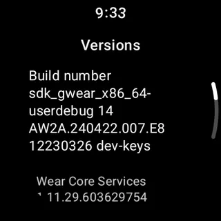
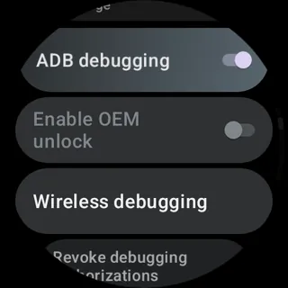
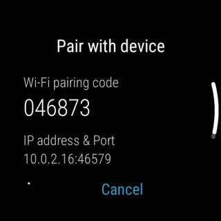
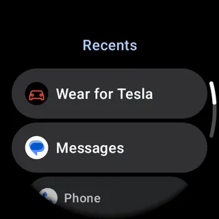
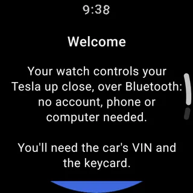

# Install the app

Wear for Tesla is not on the Play Store, and it is not on F-Droid. You install the APK yourself ("sideloading"). Updates install over the app you already have: every release is signed with the same project key, so pairing is kept.

## Requirements

- A watch with **Wear OS 4 or later** (Android 13, API level 33).
- A **Tesla Model 3 or Model Y** (other models work over Bluetooth but have no car illustration yet).
- The car's **Keycard** and its **VIN**, for pairing.
- A computer with `adb`, or an Android phone on the same Wi-Fi as the watch.

## 1. Get the APK

[Download the latest APK](https://github.com/Giack/wear-for-tesla/releases/latest){ .md-button .md-button--primary }
[Add to Obtainium](https://apps.obtainium.imranr.dev/redirect?r=obtainium://add/https://github.com/Giack/wear-for-tesla){ .md-button }

### Direct download

On the [latest release](https://github.com/Giack/wear-for-tesla/releases/latest), download `wear-for-tesla-<version>.apk`. That file is what step 3 installs.

### Obtainium, on the phone

[Obtainium](https://github.com/ImranR98/Obtainium) is an Android app for the **phone**. **Add to Obtainium** uses Obtainium's documented redirect (`https://apps.obtainium.imranr.dev/redirect?r=obtainium://add/…`) to open the [add-app link](https://wiki.obtainium.imranr.dev/deep_links/) `obtainium://add/https://github.com/Giack/wear-for-tesla`. Confirm the add. Obtainium then tracks this repository's GitHub Releases and downloads a newer APK when you check for updates.

!!! warning "Obtainium does not install the app on the watch"
    The release is a Wear OS package. Obtainium on the phone only downloads that file. If it then offers to install, the install targets the **phone**, which refuses a watch-only APK. Cancel that prompt and take the downloaded file into step 3.

    Obtainium can be sideloaded onto a watch, but that does not install Wear for Tesla. Wear OS does not let one app install another, so Obtainium running on the watch cannot install this APK unless the watch is rooted or uses Shizuku. That is a community experiment, not a supported path ([Obtainium discussion #1470](https://github.com/ImranR98/Obtainium/discussions/1470)).

## 2. Turn on wireless debugging

The watch and the computer or phone must be on the **same Wi-Fi**. Many guest and office networks block devices from seeing each other; a home network or a phone hotspot is the reliable choice.

Developer options and the two debugging switches are the same idea on every Wear OS watch. The menu names are not. The pictures are the stock Wear OS emulator: a round watch running Wear OS 5 (API 34), with the same labels as a Pixel Watch. The IP address and the pairing code on a real watch will not match the pictures. A Galaxy Watch uses the same screens, but you unlock developer options under **Settings → About watch → Software** (tap **Software version**), not under **System → About → Versions**.

!!! info "If a label has moved"
    Match the section for your watch. You are looking for the version row that unlocks developer options, then **ADB debugging** and **Wireless debugging**. [Google's wireless debugging steps](https://developer.android.com/training/wearables/get-started/debug-wifi) are the common half, after the watch-specific unlock below.

### Galaxy Watch

Samsung's [Wi-Fi debugging guide](https://developer.samsung.com/sdp/blog/en/2024/04/30/connect-galaxy-watch-to-android-studio-over-wi-fi) is the source for these labels. One UI Watch moves them slightly: older pages say **About watch → Software**, the 2024 guide says **Software information**.

1. Open **Settings → Connections → Wi-Fi** and join the same network as the computer or phone.
2. Open **Settings → About watch → Software information** (or **Software**) and tap **Software version** five times, until the watch says developer mode is on.
3. Open **Settings → Developer options**. Turn on **ADB debugging**, **Turn off automatic Wi-Fi** (so the watch stays on Wi-Fi), and **Wireless debugging**.
4. When the watch asks to allow debugging on this network, allow it.

### Pixel Watch

Google documents the unlock on the [developer options](https://developer.android.com/studio/debug/dev-options) page: **Settings → System → About → Versions → Build number**.

1. Open **Settings → Connectivity → Wi-Fi** (on some watches **Connections → Wi-Fi**) and join the same network as the computer or phone.
2. Open **Settings → System → About → Versions** and tap **Build number** seven times, until the watch says you are a developer.
3. Go back to **Settings** and open **Developer options** (on Wear OS 6 it is **Settings → Developer options**). Turn on **ADB debugging**, then **Wireless debugging**.
4. When the watch asks to allow debugging on this network, allow it.

<div class="install-shots" markdown>

<figure markdown="span">

<figcaption>System → About → Versions. Tap Build number seven times.</figcaption>
</figure>

<figure markdown="span">

<figcaption>ADB debugging on. Wireless debugging is the next row.</figcaption>
</figure>

<figure markdown="span">

<figcaption>Pair new device: the code, and the pairing IP and port.</figcaption>
</figure>

<figure markdown="span">

<figcaption>Wear for Tesla in the app list, after install.</figcaption>
</figure>

<figure markdown="span">

<figcaption>The first screen: Welcome.</figcaption>
</figure>

</div>

## 3. Install it on the watch

Pairing is once per computer or phone. Connecting is every time **Wireless debugging** was turned off, and the port often changes. Keeping the watch on its charger stops it dropping Wi-Fi mid-install.

### From a computer

Install `adb` from the [Android SDK Platform-Tools](https://developer.android.com/tools/releases/platform-tools) (version 30 or newer, which is what wireless pairing needs).

1. On the watch, open **Wireless debugging** and tap **Pair new device**. It looks like the pairing picture above: a Wi-Fi pairing code, an IP address and a **pairing** port. The connection port on the Wireless debugging screen itself is a different port; note that too.
2. Pair, then connect:

    ```sh
    adb pair <ip>:<pairing port>        # type the pairing code when asked
    adb connect <ip>:<connection port>  # the port on the Wireless debugging screen, not the pairing port
    adb devices                         # the watch is listed as <ip>:<connection port>
    ```

3. Install, replacing an earlier version if there is one:

    ```sh
    adb -s <ip>:<connection port> install -r wear-for-tesla-<version>.apk
    ```

    Use the APK from step 1. If `adb` loses the watch, open **Wireless debugging** again and repeat `adb connect` with the port now on screen.

### From an Android phone

A phone app that speaks wireless debugging can push the APK. *Wear Installer 2* and *Bugjaeger* are two that people use. They are not part of this project: follow their own instructions, pair them with the watch's **Wireless debugging** screen (IP, pairing port, pairing code, then the connection port), and pick the APK from step 1. If you used Obtainium, that is the file it downloaded, not an install it already performed.

### Open the app

Find **Wear for Tesla** in the watch's app list. The first screen is Welcome, as in the pictures above. Then follow [Bluetooth mode setup](bluetooth-mode.md). When pairing with the car is done you can turn **ADB debugging** and **Wireless debugging** off. They are only needed to install.

## Build it yourself

With JDK 21 and the Android SDK, from a clone of this repository:

```sh
cd android
./gradlew :wear:assemblePublicRelease
```

The APK is `android/wear/build/outputs/apk/public/release/wear-public-release.apk`. An APK you build yourself is signed with a different key from the releases, so switching between the two means uninstalling first and pairing the car again. Install that file with the same `adb install -r` command as in step 3.
