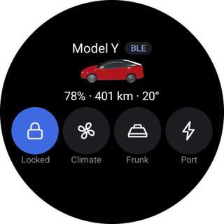

# Tile

The Tile shows battery, range, inside temperature and up to four commands without opening the app. Add it from the watch's tile list.

## What it shows

Until you change it, the four commands are **lock**, **climate**, **frunk** and the **charge port**, in that order. That is the Tile existing installs already have.

**Settings → Tile commands** picks any of the commands the app already offers, up to four, and sets their order from left to right. The choice is saved on the watch and is still there after a restart. The Tile redraws as soon as you change it.

A command that needs Fleet mode is marked **Fleet** in the list and on the Tile. Today that is **unlatch driver door**: the watch's Bluetooth key is a driver key, and the car refuses that command for the role. The other commands go over Bluetooth when the car is near, and over Fleet mode when it is not.

## What a tap does

A tap opens the same hold-to-confirm screen as a command from the app. The screen names the exact action and how old the known state is. Nothing is sent until the ring fills.

Opening or showing the Tile does not wake the car. It reads the state already on the watch, and, when the screen is on and that state is old, it tries a direct Bluetooth read of the car it already knows. A sleeping car stays asleep. Waking happens only for a command you have confirmed, or when you tap **Refresh** in the app.

## Complications

Watch-face complications are separate. **Car battery**, **Car climate**, **Lock status**, **Lock**, **Climate** and **Sentry** are added from the watch face editor, not from this screen. The [Complications](complications.md) page is the detail.
